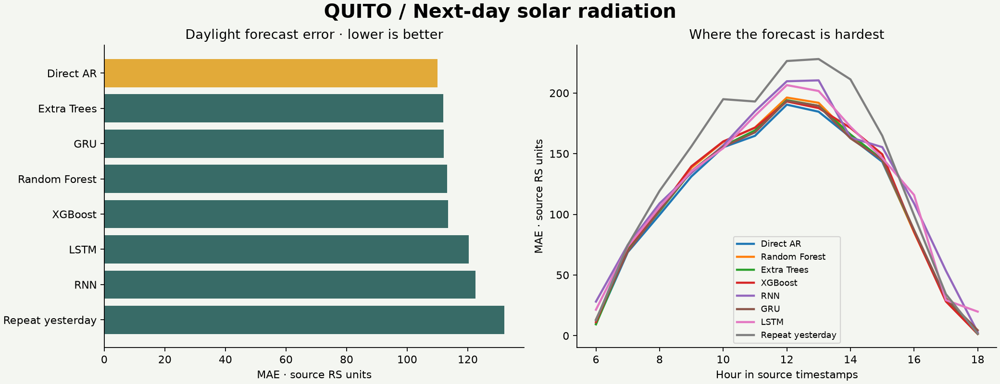
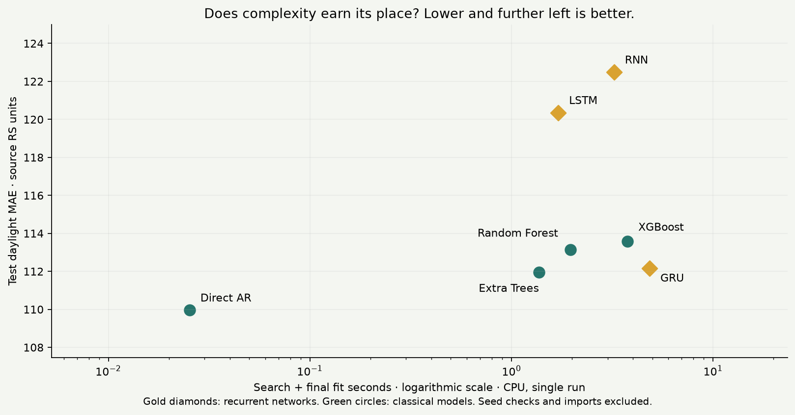

# Quito Solar — day-ahead forecasting

An applied research portfolio by **Daniel Díaz-Bedoya** ([ORCID](https://orcid.org/0009-0000-3222-6037)). This experiment builds on my solar-irradiance forecasting research to demonstrate practical results and methodological judgment for employers: predict the next calendar day's solar radiation using the preceding 24-hour window, with nighttime hours excluded from both model inputs and evaluation.

## Research behind this experiment

**Employer-facing objective: demonstrate my understanding of time series.** This portfolio connects my published research with a compact, reproducible demonstration of forecast design, leakage prevention, chronological validation, transparent architectures, small-sample limitations and the trade-off between accuracy and complexity. The following are coauthored publications; the benchmark results shown here are newly computed under the portfolio's own protocol.

1. **Díaz-Bedoya, D., González-Rodríguez, M., Clairand, J.-M., Serrano-Guerrero, X., & Escrivá-Escrivá, G. (2023).** [Forecasting Univariate Solar Irradiance using Machine learning models: A case study of two Andean Cities](https://doi.org/10.1016/j.enconman.2023.117618). *Energy Conversion and Management*, 296, 117618. This study compared AR, Random Forest and LSTM in Quito and Cuenca. The REMMAQ paragraph supplied for this project is my writing from this first article; it was located in Section 3.4 of the [institutional manuscript](https://riunet.upv.es/server/api/core/bitstreams/14e2a183-681f-45ce-af52-111a74499ccd/content).
2. **Díaz-Bedoya, D., González-Rodríguez, M., Serrano-Guerrero, X., & Clairand, J.-M. (2025).** [Solar Irradiance Forecasting With Deep Learning and Ensemble Models: LSTM, Random Forest and Extra Trees With Multivariate Meteorological Data](https://doi.org/10.1049/stg2.70019). *IET Smart Grid*, 8, e70019. Related research on multivariate forecasting in Cuenca; it is not presented as a study of this Quito CSV.

As the author, I clarify that Cuenca was the main dataset and Quito played a supporting role in the earlier research. This portfolio isolates Quito to demonstrate time-series concepts and practical judgment. Model rankings can change across cities, information sets and forecasting tasks.

**Research continuity, distinct experiment:** the 2023 article describes next-hour prediction with an 08:00–17:00 UTC−5 window. This benchmark predicts a complete next-day daylight profile (06:00–18:00) and uses different model definitions, tuning and evaluation. The published study reports LSTM improving on AR, whereas this compact experiment favors Direct AR. These findings belong to different protocols; the current ranking does not overturn the published results or establish that simpler models always win. Publication metadata and these distinctions are saved in `research.json`.

**Business question:** can yesterday's observations improve tomorrow's daylight planning compared with simply repeating yesterday?



## Explore the project

- **Separate Tail Risk Lab:** open `docs/risk/index.html` for synthetic power-law tails, regime change, and forecast-based decision risk. This is a separate page and experiment, not part of the solar benchmark. See [its protocol](RISK_LAB.md).

- **Interactive presentation:** open `docs/index.html` in a browser. It works offline, without a build or external chart service.
- **Forecast explorer:** every held-out date, every model, observed versus forecast profiles, hourly values, median-error and hardest-day shortcuts.
- **Cross-time stability:** four expanding chronological folds with exact dates, sample counts, fold MAE and descriptive standard deviation.
- **Reproducible evidence:** `results/metrics.csv`, `results/validation.csv`, `results/predictions.csv`, and `results/report.json`.

## Forecast contract

One forecast is issued at midnight in the source timestamp convention. Its information window is the immediately preceding calendar day; its targets are the daylight hours of the new calendar day. After nighttime removal, this dataset supplies **13 inputs and 13 targets (06:00–18:00 inclusive)**. This is still a next-24-clock-hours task; it is not a forecast of the next 24 retained daylight observations.

The source includes small nighttime readings up to 5 RS units. A fixed, documented noise-floor assumption identifies retained clock hours: an hour must exceed 5 at least once in the earliest training block. The same mask is used for every fold and model, without consulting validation or test observations. The raw CSV remains unchanged. Excluded hours are omitted, not falsely reported as measured zeros. Retained daylight observations are never dropped because they are low or zero.

## Models and efficient training

| Model | Implementation | Small search |
|---|---|---|
| Direct AR | Standardized ridge regression; one linear autoregressive equation per target hour | Ridge alpha 1 or 100 |
| Random Forest | Native multi-output forest, 200 trees | Minimum leaf size 3 or 10 |
| Extra Trees | Extremely randomized multi-output forest, 200 trees | Minimum leaf size 3 or 10 |
| XGBoost | Histogram trees, 120 rounds, one output per tree | Depth 2 or 4 |
| RNN | One tanh recurrent layer, last hidden state → linear 13-output head | Hidden width 8 or 16 |
| GRU | One gated recurrent layer, last hidden state → linear 13-output head | Hidden width 8 or 16 |
| LSTM | One LSTM layer, last hidden state → linear 13-output head | Hidden width 8 or 16 |
| Repeat yesterday | Copy the prior day's daylight profile | No fitting |

“Direct AR” here is a **direct, regularized seasonal autoregression**, not a recursive hourly AR(24) fitted to an artificial series with nights removed. For target hour h: `forecast(day, h) = intercept_h + sum_j coefficient[h,j] * RS(previous_day, j)`, where j ranges over retained daylight hours. This preserves the actual overnight time boundary. Negative model forecasts are clipped to zero consistently in validation and testing.

Training uses daily examples instead of overlapping hourly forecast origins. Native multi-output forests share tree structures; XGBoost uses histogram training. Two worker threads limit resource use; seed 42 fixes stochastic choices. Only two configurations per model are compared, avoiding an expensive broad search on a small dataset. Fitted models are not persisted; predictions, configurations, source hash and library versions are saved, and the script refits reproducibly.

### Recurrent training budget and architecture transparency

All three recurrent models use PyTorch on CPU, two threads, one unidirectional layer, and a sequence of shape **batch × 13 daylight steps × 1 RS feature**. The last hidden state feeds a linear head with 13 outputs. State resets for each day: there is no memory across examples and no invented continuous overnight sequence. There is no dropout, bidirectionality, attention, weather covariate, or pretrained component.

The optimizer is Adam with learning rate 0.01 and weight decay 0.001. Full-batch MSE, gradient-norm clipping at 1, and a maximum of 100 epochs keep these small datasets inexpensive. Inputs and targets each use a single training-fitted mean/std across all hours; target scaling therefore preserves the relative weighting of hourly squared errors. Output is inverse-scaled, then clipped at zero as for every learned model.

For **each fit**, the last 20% of its training block is an inner chronological stopping set. Scaling is fitted only on the earlier inner portion. A 0.01-RS improvement in stopping-set MAE resets patience (12 epochs). The best epoch count is selected, then weights and scalers are reset and the model is refitted on the whole training block for that many epochs. The four outer validation folds are never used for gradient updates or stopping. These inner stopping sets are only **41, 52, 62, 72 days**, and 83 days for the final fit; their short duration can make epoch selection noisy. This limitation is additional to the short outer validation windows.

The dashboard's **Model info / Full transparency** section and `report.json → architectures` expose the selected width, parameter count, final epochs, stopping-search epochs, preprocessing and optimizer for recurrent models, and the selected regression/tree settings for every classical model and baseline. Defaults not explicitly overridden follow the pinned library versions.

Primary neural results always use seed 42. Additional seeds 7 and 123 refit only the selected architecture using the seed-42 epoch count; no ensemble or best-seed selection is used. Their MAEs are in `results/seed_sensitivity.csv`. This small sensitivity check is not a seed distribution estimate or a statistical test.

## Cross-time validation and leakage controls

There are 515 complete days and 514 prior-day/next-day pairs. The split is made by **target date**, never by shuffled rows:

| Fold | Training examples | Validation examples | Target index boundaries |
|---|---:|---:|---|
| 1 | 205 | 52 | Train [0,205), validate [205,257) |
| 2 | 257 | 51 | Train [0,257), validate [257,308) |
| 3 | 308 | 51 | Train [0,308), validate [308,359) |
| 4 | 359 | 52 | Train [0,359), validate [359,411) |
| Final | 411 | 103 test days | Train [0,411), test [411,514) |

Each model's configuration minimizes pooled validation MAE across all four folds. The overall model is selected on that validation score, then refitted on all 411 pre-test examples. The held-out period is **2018-03-20 to 2018-06-30**. Models are fixed within each validation/test block; observed previous-day inputs are updated daily. This simulates sequential day-ahead use, not issuing 103 days of forecasts at once.

Scaling is fitted within each training fold. Daylight selection uses only the earliest training block. Training targets end before the next block's targets begin. A validation input can equal the preceding training target because that observation is already known at forecast issue time; this is legitimate historical context, not target leakage. Daily target windows do not overlap, so no additional gap is needed for this forecast contract. No future VEL, TMP or HUM values are used.

**Small-window limitation:** each validation block spans only 51–52 days. Weather regimes, season mix and serial correlation can materially move fold MAE; effective sample size may be smaller than the day count. Fold standard deviation is a descriptive population SD of four scores, **not** a confidence interval, statistical significance test, or proof of structural model instability. Low SD alone does not mean a good forecast. These folds also tune parameters, so their scores have selection optimism; the final test is the independent check. A longer multi-year dataset and longer seasonal holdouts are needed to support strong stability claims.

## Evaluation and business interpretation

Recorded run (103 held-out days; lower is better):

| Model | Daylight MAE | Reduction vs. repeat yesterday |
|---|---:|---:|
| Direct AR | 109.96 | 16.7% |
| Extra Trees | 111.96 | 15.2% |
| GRU | 112.15 | 15.1% |
| Random Forest | 113.14 | 14.3% |
| XGBoost | 113.57 | 14.0% |
| LSTM | 120.35 | 8.8% |
| RNN | 122.48 | 7.2% |
| Repeat yesterday | 132.03 | — |

Direct AR was selected by validation and also had the lowest test MAE. Its fold MAEs were 131.99, 127.89, 120.66 and 130.20 RS units (descriptive SD 4.31). These numerical differences do not establish statistical superiority.

### Does added complexity pay off?

**For this task and compact search budget, the evidence favors Direct AR.** GRU is the validation-selected recurrent model and its primary test MAE is **2.0% worse** than Direct AR. LSTM is **9.5% worse** and RNN **11.4% worse**. All three still beat repeat-yesterday persistence, so they do learn useful structure; they simply do not improve on the strongest simpler model here.

The three tested seeds give MAE ranges of **112.15–114.44 (GRU)**, **118.60–129.84 (LSTM)**, and **119.51–122.48 (RNN)**. None beats Direct AR's 109.96. The larger LSTM seed variation is a reminder that a single neural initialization can be misleading.

The dashboard reports measured search-plus-final-fit seconds and final-fit seconds separately. Neural final-fit time includes the inner epoch search and full-data refit. Search totals include eight candidate/fold fits plus the final fit and evaluation; they exclude extra seed checks, imports, dependency installation and plotting. Seed checks have their own recorded fit times. These are single-run CPU wall times, not repeated hardware benchmarks; first-use initialization and system load can affect them. A full experiment takes seconds rather than requiring GPU infrastructure. **The case for simplicity is no observed accuracy gain plus extra training and maintenance machinery, not a claim that neural runtime is unaffordable.** Small absolute costs matter more than impressive ratios against a millisecond linear fit.



This is not evidence that recurrent models are universally worse: only two small widths, one learning rate, one optimizer and a short univariate context were tested. Larger datasets, longer contexts, weather inputs or a different tuning budget could change the result. Statistical superiority and financial value have not been established.

**Historical-test reuse notice:** this test period was already inspected in the original classical-model benchmark. The neural extension uses the same fixed split and does not tune to these test scores, but it is not a new, blind confirmatory experiment. Fresh external data is needed to confirm the expanded model comparison. The seed checks also inspect this existing test period.

All reported errors exclude night hours. MAE is the primary metric; RMSE emphasizes large misses; bias measures directional error; the 95th percentile of daily MAE and worst-day explorer expose adverse cases. MAPE is omitted because near-zero sunrise/sunset observations make it unreliable. Skill is `100 * (1 - model_MAE / persistence_MAE)`.

`daily_total_mae` is the absolute error in the **sum of retained hourly RS readings**, not a verified energy estimate. It can hide offsetting hourly errors and must not replace hourly MAE. Radiation improvements may support storage or backup planning, but this project does not infer PV output, guaranteed reliability or financial savings without equipment, measurement-unit and cost information.

The hardest observed day is a historical stress case. It is not evidence of a black-swan event; unprecedented regimes remain outside the demonstrated scope. No calibrated prediction intervals or statistical superiority claims are made.

## Data notice

**Provider attribution:** Red Metropolitana de Monitoreo Atmosférico de Quito (**REMMAQ**). The project owner identified this provider and the [Quito environmental data portal](https://datosambiente.quito.gob.ec/) on 2026-10-18. The REMMAQ attribution is corroborated in Section 3.4 of the 2023 article. The specific CSV export has not yet been independently matched to a portal record. Structured provenance is saved in `data_source.json` and included in generated results.

According to the study background supplied by the owner, the broader meteorological collection spans **2004–2018**, covering solar irradiance, wind velocity, temperature, precipitation and humidity. The study selected **2017–2018** following a data-quality review. This is an attributed description of the study's selection process, not a quality assessment independently reproduced by this project: the original article and passage are now identified, but the underlying review criteria and quality flags have not been supplied. These observations are historical, not current conditions.

**File actually analyzed:** `quito_2017_2018 (1).csv`, containing 12,360 consecutive hourly rows from **2017-02-01 through 2018-06-30**, with columns `Date_time`, `RS`, `VEL`, `TMP`, `HUM`. It is a subset of the stated 2017–2018 period, not two complete calendar years. **Precipitation is not present in this CSV**, even though it appears in the broader source description. Only RS is used in this benchmark.

The audit found **no missing values, missing hourly timestamps or duplicate timestamps**. The pipeline deliberately stops if such issues occur: ask the owner how to handle them before any imputation or deletion.

**Still pending:** the specific dataset/export URL, station, RS units, timezone, measurement aggregation, reuse license, and underlying quality-review documentation. The portal URL establishes the supplied source reference but does not by itself resolve these details. Automated access returned HTTP 403 on 2026-10-18, so portal content could not be independently inspected. The 2023 article describes hourly average global irradiance in W/m² and uses UTC−5; this is now recorded as published measurement context. Dashboard labels remain in source RS units pending confirmation of this exact export. The project owner confirmed permission to publish the solar data on 2026-10-18. This confirmation is recorded in `data_source.json`; it does not establish a general downstream reuse license.

## Reproduce

Python 3.13 was used for the recorded run. From the repository root:

```powershell
python -m venv .venv
.\.venv\Scripts\python.exe -m pip install -r requirements.txt
.\.venv\Scripts\python.exe src/train.py
.\.venv\Scripts\python.exe -m unittest discover -s tests -v
```

Training regenerates all result files, `docs/data.js`, and `docs/benchmark.png`. Floating-point values and timings may differ across platforms. The JSON records the actual package versions and source SHA-256. The benchmark is a fixed protocol; do not repeatedly tune against the published test results.

On Windows, double-click **`start-dashboard.cmd`**. It opens a terminal, starts the dashboard at `http://127.0.0.1:8000`, and opens your browser. **Close that terminal window or press Ctrl+C to stop the server.** The browser tab may remain visible after shutdown. The server runs in the foreground, only on your computer; it is not installed as a background service. It uses the local virtual environment when available, otherwise an installed Python 3. No additional packages are needed to view the dashboard. If port 8000 is already occupied, the launcher reports the error without stopping another application.

Any preview servers started during development should be stopped when work finishes.

For GitHub Pages, publish the repository's `docs/` folder from your chosen branch after resolving publication details. This workspace has not been uploaded or deployed.

## Technical references

- [Scikit-learn native multi-output forest example](https://scikit-learn.org/stable/auto_examples/ensemble/plot_random_forest_regression_multioutput.html)
- [ExtraTreesRegressor](https://scikit-learn.org/stable/modules/generated/sklearn.ensemble.ExtraTreesRegressor.html)
- [PyTorch LSTM architecture](https://docs.pytorch.org/docs/stable/generated/torch.nn.modules.rnn.LSTM.html)
- [PyTorch RNN architecture](https://docs.pytorch.org/docs/stable/generated/torch.nn.RNN.html)
- [PyTorch GRU architecture](https://docs.pytorch.org/docs/stable/generated/torch.nn.GRU.html)
- [XGBoost multi-output support](https://xgboost.readthedocs.io/en/stable/tutorials/multioutput.html) — the upstream feature is described as experimental; the exact installed version is recorded.
